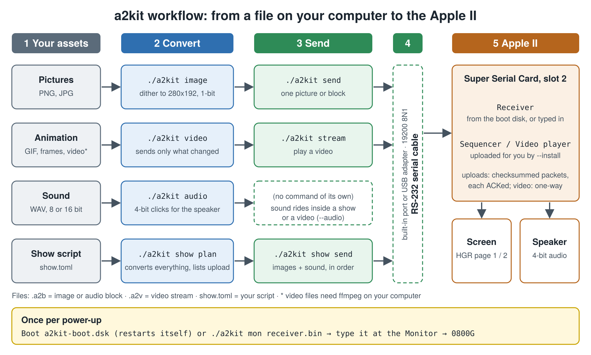

# a2kit Quick Start

## Purpose

**a2kit turns pictures, animations and sound from your modern computer into things an Apple II can show and play.**
It converts your files into the Apple II's own formats (280×192 black-and-white hi-res graphics, one-bit speaker audio),
then sends them over a serial cable to an Apple II, II+ or IIe that has a Super Serial Card.
The Apple II doesn't get any faster; it borrows the heavy lifting from your computer, and
you get a title screen, a slideshow with sound, or a short looping animation on real hardware.

This guide gets you from nothing to a picture on the screen. The full detail of every command is in the [User Manual](MANUAL.md).

> **Status:** a2kit has been run on one real setup: a 1979 Apple II+ with a Super Serial Card II, booted from a Floppy Emu,
> driven from Linux over a built-in serial port ([tested setup](INSTALL.md#tested-setup)). If yours differs, treat your first run as a bring-up:
> if something doesn't work, see [Troubleshooting](MANUAL.md#10-troubleshooting).

## How it fits together



*(Vector version: [workflow.svg](workflow.svg).)* In short: **convert** a file, **send** it, **watch** it.
Once per power-up you start the small *receiver* program on the Apple II, either by booting the a2kit disk or by typing it in; after that, everything is driven from your computer.

## What you need

Full details are in the [Installation Guide](INSTALL.md), including the complete [hardware requirements](INSTALL.md#hardware) (other Apple II models, the cable, speed); this is the short version.

| | |
|---|---|
| **Your computer** | Python 3.11 or newer, with `pillow`, `numpy` and `pyserial` (`python3 -m pip install -r requirements.txt`). Optional: `cc65` to rebuild the 6502 programs (the built ones are included), `ffmpeg` to convert video files. |
| **Apple II side** | A 48K Apple II, II+ or IIe at its normal speed, with a **Super Serial Card in slot 2**. To boot the a2kit disk you also need a 16-sector Disk II drive (or a Floppy Emu); if you type the receiver in, no disk is needed. |
| **Cable** | An **RS-232** serial port on your computer: a built-in one, or a USB-to-RS-232 adapter (not a 3.3 V / 5 V "USB-TTL" board). Plus a DB-9-to-DB-25 cable or adapter, with the null-modem wiring your card needs. Its port name is `/dev/ttyS0` (built-in) or `/dev/ttyUSB0` (USB) on Linux, `/dev/cu.usbserial-…` on macOS, `COM3` (or similar) on Windows. |

You can do Steps 1 and 2 with **no Apple II at all**.

## Step 1. Check your setup

Install the requirements first if you haven't ([Installation Guide](INSTALL.md)). Then, from the `a2kit` folder:

```bash
./a2kit doctor
```

It lists anything missing and how to fix it. (On Windows, use `python tools/a2kit.py` wherever this guide says `./a2kit`.)

## Step 2. Try it with no hardware

The `examples/` folder has starter assets: two pictures, a bouncing-ball animation, and three short sounds
(see [Starter assets](#starter-assets)). These commands convert them and show you what the Apple II will see.

<!-- test:no-hardware -->
```bash
mkdir -p out

# A picture. --preview writes a PNG of exactly what the Apple II screen will look like.
./a2kit image examples/logo.png   -o out/logo.a2b   --preview out/logo_preview.png
./a2kit image examples/sphere.png -o out/sphere.a2b --preview out/sphere_preview.png

# An animation (a folder of frames, or the GIF): 6 frames per second.
./a2kit video examples/frames -o out/bounce.a2v --fps 6

# The same animation with a "boing" sound added between frames.
./a2kit video examples/frames -o out/bounce_sound.a2v --fps 6 --audio examples/boing.wav

# A stress test at the full byte budget, without and with sound (see Step 6). Hard edges, so no dithering.
./a2kit video examples/stress -o out/stress.a2v --fps 6 --dither threshold
./a2kit video examples/stress -o out/stress_sound.a2v --fps 6 --dither threshold --audio examples/jingle.wav

# A whole show (two pictures and two sounds): convert everything and print the upload plan.
./a2kit show plan examples/show.toml

# A fresh copy of the boot disk (one comes with a2kit; this shows how to remake it).
./a2kit disk -o out/a2kit-boot.dsk
```

Open `out/logo_preview.png` and `out/sphere_preview.png`. The sphere is the best one to look at: it shows how a smooth
grey gradient becomes a pattern of black-and-white dots. That is how the Apple II draws shades.

The `video` command prints how many bytes each frame needs and warns if the picture can't keep up
(`unsent screen bytes after last frame` should be **0** for the bouncing ball).

## Step 3. Start the receiver on the Apple II

The receiver is a 374-byte program that listens on the serial card. There are two ways to start it.

### Option A: boot the a2kit disk (easiest)

`a2kit-boot.dsk` (in the `a2kit` folder) is a 140 KB 5.25-inch disk image that boots straight into the receiver.
It has no DOS on it, so all of the Apple II's memory stays free.

1. Get the image onto something your Apple II can boot: copy it to a Floppy Emu's SD card, write it to a real floppy, or open it in an emulator.
   The [Installation Guide](INSTALL.md#5-the-boot-disk) lists the ways.
2. Connect the serial cable, put the disk in drive 1 (slot 6) and turn the Apple II on (or type `PR#6` at the BASIC prompt).
3. The screen clears and shows `A2KIT RX READY 115200 (ANY KEY QUITS)`. The number is the line speed in baud.

Booted this way, the receiver **starts listening again by itself after every session**, on a freshly cleared screen, so you never type `0800G`.
Pressing a key while it is waiting drops you into the Monitor; type `980G` there to start it again.

### Option B: type it in

1. On your computer, print it as Monitor lines:

   ```bash
   ./a2kit mon receiver.bin
   ```

   You get 47 lines like `0800:78 A9 00 85 CE 85 EC A4`, then a last line, `0800G`.

2. On the Apple II, get to the Monitor prompt (`*`). From BASIC that's `CALL -151`.
3. Type the lines exactly as printed, pressing Return after each one. **Don't type the last line yet.**
4. Check your typing: type `0800.0975` and compare the dump with the printed lines.
5. Connect the serial cable, then type **`0800G`**. The screen shows `A2KIT RX READY 115200 (ANY KEY QUITS)`.

Typed in, the receiver stops after each session, so type `0800G` again before every send.

Either way, the receiver is now waiting. Leave it running and go back to your computer.

**If the link is unreliable:** `a2kit-boot-19200.dsk` is the same receiver at 19200 baud, a sixth of the line speed (a picture in 4.8 s instead of 0.9). Boot it and add `--baud 19200` to the commands, or run `export A2KIT_BAUD=19200` once. See [Line speed](MANUAL.md#24-line-speed-115200-or-19200-baud) in the User Manual.

## Step 4. Check the link, then send your first picture

First make sure the computer and the Apple II can hear each other:

```bash
./a2kit ping --port /dev/ttyUSB0
```

Replace the port with yours. Watch the Apple II's bottom line count up `A2KIT PING 1 OF 10` … `10 OF 10`; on your computer
the summary should end with `Link OK`. If it doesn't, its last lines say what kind of problem it found (see
[`a2kit ping`](MANUAL.md#a2kit-ping) in the manual). The receiver is still listening afterwards, so carry straight on:

```bash
./a2kit send out/logo.a2b --port /dev/ttyUSB0
```
 It takes about a second. When it finishes, the logo appears on the Apple II screen.
Press any key on the Apple II to go back to text.

If you typed the receiver in, type `0800G` again now; the boot disk's receiver is already listening.

## Step 5. Run the starter show

A *show* is a list of scenes (pictures, sounds, pauses) described in a small text file. The starter one is `examples/show.toml`.

```bash
./a2kit show send examples/show.toml --port /dev/ttyUSB0 --install
```

`--install` also sends the sequencer program that plays the scenes; you need it once per power-up.
You should see the logo for three seconds, then the jingle plays over it, then the sphere for three seconds, then a chirp, then a
one-second pause before the screen returns to text. Press a key to stop between scenes.

## Step 6. Play the animation

Make sure the receiver is listening (boot disk: it already is; typed in: `0800G`), then:

```bash
./a2kit stream out/bounce_sound.a2v --port /dev/ttyUSB0 --install
```

A ball bounces across the screen for about eight seconds, with the "boing" sounds spread through the clip. They are not lined up
with the individual bounces: the sound plays in order, in short bursts between frames, because the Apple II can't listen to the cable and drive the speaker at the same time
(see [the manual](MANUAL.md#5-a2kit-video)).

**A harder test:** `out/stress.a2v` sends as much as the line allows at 115200 baud, and `out/stress_sound.a2v` adds the jingle in 27 short bursts:

```bash
./a2kit stream out/stress.a2v --port /dev/ttyUSB0 --install
```

For about 8 seconds, rings and a spinning cross move all over the screen, looking smeared because each frame can only redraw part of what changed. Then a still grid with a circle stays up for about 7 seconds. The grid is what to check: bytes lost during the motion would show up on it as stray marks or gaps. These clips are made for 115200 baud and run late at 19200.

## Step 7. Make your own

- **A picture:** `./a2kit image mypic.png -o out/mypic.a2b --preview out/mypic_preview.png`, then look at the preview.
  Use `--crop` to fill the screen instead of letterboxing, and `--invert` if it comes out too dark.
- **An animation:** put frames in a folder (`frame001.png`, `frame002.png`, …) or use a GIF. Keep the background plain and the moving part small.
- **A show:** copy `examples/show.toml` and change the file names.
- **Sound:** short is best. A show or video holds about 6 seconds of sound in total.

## Starter assets

All of these were generated by `examples/make_examples.py` and are free to use and change. Re-run it to rebuild them.

| File | What it is | Good for |
|---|---|---|
| `examples/logo.png` | Title card: "A2KIT / HELLO, APPLE II" | Your first `image` and `send` |
| `examples/sphere.png` | Shaded ball on a checkered floor | Seeing how grey dithers to dots |
| `examples/frames/f00.png … f35.png` | 36 frames of a bouncing ball | `video` from a folder |
| `examples/bounce.gif` | The same animation as a GIF | `video` from a GIF |
| `examples/stress/f000.png … f089.png` | 90 frames: moving rings, then a still test grid | Testing the link at the full byte budget |
| `examples/jingle.wav` | Six-note rising jingle, 1.7 s | Sound in a show |
| `examples/boing.wav` | Three "boing" sounds, 0.9 s | Sound in a video (`--audio`) |
| `examples/chirp.wav` | Rising chirp, 0.5 s | A short effect |
| `examples/show.toml` | Logo, jingle, sphere, chirp | `show plan` / `show send` |

## Where next

- [User Manual](MANUAL.md): every command and option, file formats, memory map, limits and troubleshooting.
- `./a2kit --help`, or `./a2kit COMMAND --help` for any single command.
- `./a2kit test` runs the full test suite if you change something.
